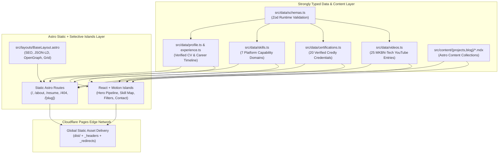

# System & Frontend Architecture (`www.mkbn.in`)

## 1. Architectural Overview
The **Mohan Kumar BN Senior Platform Engineer & SRE Portfolio (`www.mkbn.in`)** is engineered as a static-first, high-performance web application using **Astro 5**, **Strict TypeScript**, **Tailwind CSS**, **MDX Content Collections**, and selective **React + Motion** interactive islands deployed on **Cloudflare Pages**.

## 2. Design System ("Mission-Critical Cloud-Native Control Plane")
- **Primary Canvas**: Obsidian Black (`#080B12`)
- **Elevated Surfaces**: Deep Slate (`#101522`) & Midnight Blueprint (`#151B2B`)
- **Accent Palette**: Electric Blue (`#3B82F6`), Telemetry Cyan (`#22D3EE`), Orchestration Violet (`#8B5CF6`), and SLA Emerald (`#10B981`)
- **Typography**: Geometric sans-serif display headings paired with `JetBrains Mono` for cluster metrics, CLI commands, and topology badges.

## 3. Performance & Accessibility Engineering
- **Static Pre-Rendering**: All 30+ HTML routes are pre-rendered at build time (`output: 'static'`).
- **Privacy-First Media**: YouTube videos use click-to-load `youtube-nocookie.com` embeds so zero third-party iframes block initial page load.
- **Reduced Motion**: Every animated component respects `prefers-reduced-motion: reduce` via both CSS media queries and Motion's `useReducedMotion()` hook.
